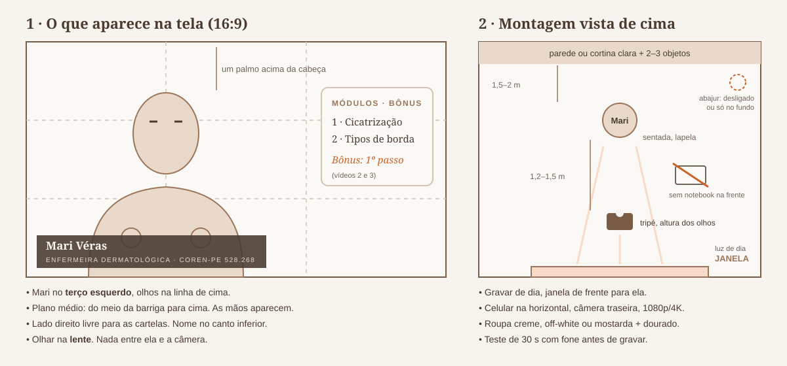

# Roteiro: regravação do vídeo de apresentação do curso (com o bônus)

**Substitui:** a gravação teste `c705d4a5.mp4` (2min20, gravada em casa à noite). Transcrição em `transcricoes/curso-apresentacao-alem-do-curativo.txt`; avaliação em `estilo-em-video.md`, seção 14.
**Público:** enfermeiros e técnicos de enfermagem (Brasil).
**Duração alvo:** 2min a 2min15 · **~290 palavras** (ela fala ~155 palavras/min quando grava com calma).
**Formato:** 16:9, 1920×1080 ou 4K.

## O que muda em relação à gravação teste

| Na gravação teste | Na nova versão |
| --- | --- |
| Abre com "Além do curativo, estamos aqui para iniciar…" (sem dizer quem ela é nos primeiros segundos) | Abre com boas-vindas + nome + título em 10 segundos |
| Frases longas, emendadas por "e…né" | 6 blocos curtos, gravados separados |
| O bônus aparece só no fim, em uma frase | O bônus ganha um bloco próprio, com o que a pessoa leva |
| "para mostrar os meus resultados" | "para mostrar que é possível", sem soar como promessa de resultado (COFEN) |
| A melhor frase ("a borda comunica o erro") fica no meio de uma frase longa | Vira o momento de virada, com pausa |
| Noite, luz quente, notebook na frente, plano aberto | Dia, luz de janela de frente, nada na frente, plano médio (ver "Orientação visual") |

---

## Roteiro

Cada bloco é gravado separado (2 tomadas). **Negrito** = falar do jeito que está escrito. O resto é guia: pode dizer com as suas palavras.
Gestos entre parênteses são os que ela já faz naturalmente; servem só de lembrete.

### Bloco 1 · Abertura (0:00–0:15) · ~35 palavras
*Olhando para a lente, sorriso.*

> **"Seja muito bem-vindo, seja muito bem-vinda ao Além do Curativo. Eu sou a Mari Véras, enfermeira dermatológica, e a partir de agora a gente vai caminhar junto nessa jornada."**
> (mãos se abrem em "a gente vai caminhar junto")

**Na tela:** cartela de nome no terço inferior esquerdo (ver "Edição").

### Bloco 2 · Quem eu sou e por que feridas (0:15–0:50) · ~85 palavras
*Tom de conversa. Pode olhar para o lado ao lembrar, e voltar para a lente.*

> Eu sou do interior de Pernambuco, me formei pela UFCG em 2017 e sou intensivista. Já passei pela UTI adulto, pela UTI pediátrica e trabalhei muito tempo na gestão hospitalar.
> E chegou um momento em que eu percebi que não podia ir além. Eu estava presa à regra da instituição, à escala, à rotina.
> **Foi aí que eu decidi empreender. E escolhi o mundo das feridas, porque foi nele que eu encontrei a minha missão: transformar a vida do paciente e da família dele.**
> (mão no peito em "minha missão")

Tópicos (se preferir falar sem texto):
- interior de PE · UFCG 2017 · intensivista: UTI adulto, UTI pediátrica, gestão
- "não podia ir além": regra, escala, rotina
- decidi empreender → feridas → missão: paciente e família

### Bloco 3 · A virada: a borda (0:50–1:20) · ~65 palavras
*Mais devagar. Este é o coração do vídeo.*

> Sabe qual é a maior dificuldade que eu vejo, em quem cuida e em quem está começando? É entender como a cicatrização funciona.
> A gente se preocupa tanto com a cobertura, com o tecido do leito da ferida… e esquece de olhar ao redor.
> **"E a borda comunica o erro."** (indicador levantado · pausa de 1 segundo)
> **"Olhar ao redor, perceber os detalhes: isso vale para a ferida e vale para a vida."** (sorriso)

### Bloco 4 · O que tem no curso (1:20–1:40) · ~45 palavras
*Ritmo leve, contando nos dedos.*

> Nos módulos, você vai entender **como funciona a cicatrização** e **quais são os tipos de borda**, e como isso muda a sua conduta. [CONFERIR: nomes e número de módulos]
> São vídeos curtos, para você assistir **com calma**, no seu tempo, e voltar sempre que precisar.
> (conta nos dedos: 1, 2)

**Na tela:** lista dos módulos entrando um a um (cartela creme, à direita dela).

### Bloco 5 · O bônus (1:40–2:05) · ~55 palavras
*Energia sobe um pouco. Aqui ela fala do que viveu.*

> E no final tem um bônus que eu preparei com muito carinho: **vou te contar a minha trajetória de empreender na enfermagem**, do jeito que ela foi, com o que deu certo e com o que eu aprendi errando.
> **E vou te ajudar a dar o primeiro passo, começando pela sua realidade de hoje.** [CONFERIR: formato do bônus: aula, PDF, encontro ao vivo?]
> (mãos abertas para a frente em "primeiro passo")

**Na tela:** cartela "BÔNUS · Empreender na enfermagem: o primeiro passo".

### Bloco 6 · Fechamento (2:05–2:15) · ~25 palavras
*Olhando para a lente, sorriso aberto. Segurar 2 segundos em silêncio no fim.*

> **"Então pega o seu caderno, assiste com calma, e vamos juntos. Viva o seu novo momento na enfermagem."**
> (sorriso · 2 s parada · corte)

**Total: ~290 palavras · ~2min05 a 2min15.**

**Revisar antes de publicar:** nomes dos módulos e do bônus; "intensivista" e as experiências (são dela, mas confirme como quer dizer); nada de promessa de faturamento no bônus; assinatura "Enf. Mari Véras · Enfermeira Dermatológica · COREN-PE 528.268" na cartela.

---

## Orientação visual

### Enquadramento (o que aparece na tela)
- **16:9, plano médio:** do meio da barriga para cima. As mãos precisam caber no quadro: são metade da fala dela.
- **Posição:** Mari no **terço esquerdo** (ombro na linha vertical da esquerda), **olhos na linha do terço superior**. O lado direito fica livre para as cartelas dos módulos e do bônus.
- **Espaço acima da cabeça:** um palmo pequeno (não colar a cabeça no topo, não deixar meia tela vazia).
- **Olhar:** na **lente**, não na tela do celular. Se usar o celular como câmera, cubra a tela ou use a traseira.

### Montagem (onde fica cada coisa no ambiente)
- **Janela de frente para ela**, atrás da câmera ou a 45°. Gravar **de dia** (9h–11h ou 15h–16h30, sem sol direto no rosto).
- **Câmera/celular no tripé, na altura dos olhos**, a **1,2–1,5 m** dela. Câmera traseira, 1080p ou 4K, 30 fps, foco e exposição travados no rosto.
- **Ela sentada** numa cadeira sem rodinha, costas retas, um pouco inclinada para a frente (como nos reels da mesa). Mesa opcional: se tiver mesa, **nada em cima entre ela e a câmera** (sem notebook). Se precisar de cola, celular com teleprompter **colado logo abaixo da lente**.
- **Fundo a 1,5–2 m atrás dela:** parede ou cortina clara, com **2 ou 3 objetos** do mundo dela (livros, uma planta, o cacto). Nada de janela com rua ou cidade atrás.
- **Abajur:** desligado, ou ligado só como ponto de luz no fundo (nunca a luz principal).
- **Lapela** presa no meio do peito, fio escondido por dentro da roupa. Desligar ventilador e ar-condicionado durante a tomada.

### Figurino
- **Creme, off-white ou mostarda** (como a série do Clinical Center), com os acessórios dourados de sempre. Sem jaleco (o tom é de conversa).
- Evitar preto (pesa e some no fundo) e listras finas (tremem na câmera).

### Edição
- **Cartela de nome** (bloco 1, 0:03–0:08), terço inferior esquerdo: "Mari Véras" em Georgia Bold creme + linha "ENFERMEIRA DERMATOLÓGICA · COREN-PE 528.268" em Arial caixa-alta espaçada, sobre faixa marrom `#4A3A30` a 85%.
- **Cartelas dos blocos 4 e 5** no lado direito, cartão creme `#FBF9F6` com borda `#D6C3B0`, título em Georgia e destaque em terracota/caramelo (ver `identidade-visual.md`).
- **Bloco 3:** sem cartela; no máximo a frase "A borda comunica o erro." em Georgia itálico, entrando na pausa.
- Legenda opcional (aula para assistir com calma): no terço inferior, frase inteira, branca com contorno marrom. Não use a legenda palavra a palavra dos reels.
- Música: nenhuma ou instrumental bem baixa só na abertura e no fecho.
- Cortes: só entre blocos; dentro do bloco, cortar apenas tropeços.

---

## Plano de gravação (de onde sai o tempo)

**Total: ~40 minutos**, numa manhã sem atendimento.

1. **10 min · montar:** tripé, luz, fundo, lapela.
2. **2 min · teste:** gravar o bloco 1, assistir no celular com fone e conferir luz, foco, som e enquadramento.
3. **20 min · gravar:** blocos 1 a 6, 2 tomadas cada; entre os blocos, respirar e reler os tópicos. Não precisa acertar tudo de uma vez.
4. **5 min · conferir:** assistir a melhor tomada de cada bloco e anotar o tempo.
5. Mandar os arquivos originais (sem compactar pelo WhatsApp: usar Drive ou cabo) para a edição.
